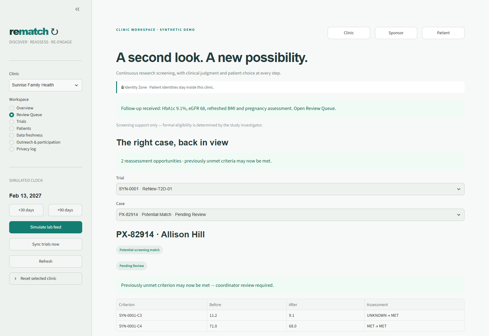
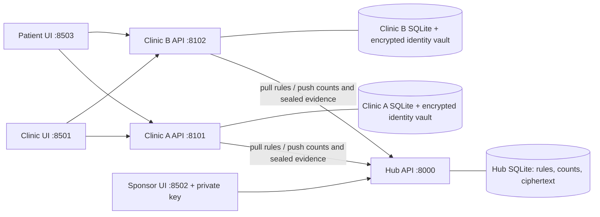
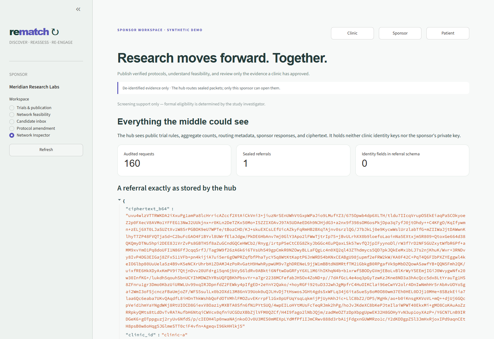

# ReMatch

**Discover. Reassess. Re-engage. Retain.**

A patient screened out once should not disappear when their clinical facts change. ReMatch demonstrates clinic-controlled, continuous clinical-trial screening: local Python rules reassess synthetic records, coordinators review new opportunities, sponsors receive encrypted minimum-necessary evidence, and patients choose whether to continue.

**[Setup and the judges' walkthrough → DEMO.md](DEMO.md)**

```powershell
python scripts/setup.py
.\.venv\Scripts\python.exe scripts/run_demo.py --reset
```

Already installed on this workspace: only the second command is needed. Alternatively use `uv sync --locked --python 3.12`, then `uv run scripts/run_demo.py --reset`. On macOS/Linux replace `.venv/Scripts/python.exe` with `.venv/bin/python`.

| Workspace | Address | Purpose |
| --- | --- | --- |
| Clinic | http://localhost:8501 | Local records, deterministic screening, reassessment, review, outreach, privacy log |
| Sponsor | http://localhost:8502 | Verified protocol publication, network aggregates, candidate review, ciphertext inspector |
| Patient | http://localhost:8503 | Research preferences, clinic-released opportunities, interest, withdrawal |

No paid API key is needed. The five synthetic protocols and an actual cached ClinicalTrials.gov source record ship with the project. The core demo works offline after dependency installation. Optional OpenAI extraction receives public trial text only and produces unverified drafts; it is not used to evaluate patients.

## The demo moment

At day zero, **PX-82914** has HbA1c **11.2%** and does not meet ReNew-T2D-01's **7.5–10.0%** criterion. After 90 simulated days, old facts become stale. A separate simulated follow-up feed supplies HbA1c **9.1%**, eGFR **68**, BMI and pregnancy assessment. A new coordinator task shows the before/after evidence. Nothing is inferred merely because time passes.

The coordinator approves a current potential match, the clinic seals an allow-listed packet to the sponsor, and the hub relays ciphertext. The sponsor confirms for clinic follow-up. The clinic releases a plain-language card; the patient can express interest, defer, decline or withdraw. A coordinator records any screening referral. There is no automatic enrollment.



## Six local processes, three separate databases



The clinic selector routes each request to the selected clinic's HTTP API; UIs do not read clinic databases. APIs bind to loopback and require service-scoped credentials. Clinics pull protocols and sponsor responses every five seconds. All simulated clinical timing comes from each clinic's persisted clock.

| Crosses the clinic boundary | Stays clinic-local |
| --- | --- |
| Public trial criteria | Names, MRNs, DOBs, contact details |
| Suppression-controlled counts | Complete clinical histories and local patient IDs |
| Sealed criterion-relevant evidence | Identity keys, pseudonym mappings, coordinator notes |
| Sponsor decisions and retractions | Patient interest and screening-arrangement details |

The matcher never decrypts identities. Each clinic uses independent **AES-256-GCM** keys with authenticated clinic/patient binding. Candidate evidence uses **PyNaCl SealedBox**, per-trial HMAC pseudonyms, age bands and relative timing. PII guards check schemas, patterns and exact seeded identity fingerprints. Changes in consent, data freshness or protocol version trigger review or retraction as appropriate. Offline retractions are persisted and retried.



## Validation and useful commands

```powershell
.\.venv\Scripts\python.exe -m pytest -q
.\.venv\Scripts\python.exe scripts/run_demo.py --reset --check
# With the demo running; resets synthetic Clinic A:
.\.venv\Scripts\python.exe scripts/check_demo.py --repeat 3
```

Tests cover three-state/exclusion semantics, boundaries and units, staleness, hero rematching, idempotency, consent, protocol amendments, authenticated identity encryption, wrong-key failures, per-trial pseudonyms, packet guards, hub leak scanning, pipeline transitions and offline withdrawal/retraction. Streamlit's official AppTest driver exercises every page and the complete workflow; an optional isolated Playwright test captures screenshots and a captioned backup video.

For a new recording install development tools with `uv sync --extra dev`, install a supported Playwright browser/FFmpeg, then run `scripts/record_demo.py --record` with the demo running. The default uses installed Microsoft Edge; use `--channel chromium` for Playwright Chromium. A prepared local backup is at `artifacts/rematch-backup.webm` (ignored by Git); screenshots are included under `docs/screenshots/`.

## Scope and honest limits

Built for the **November 15, 2026 HackRx** brief: primary positioning **Best Translational Science**, secondary **Best Clinical Impact**. The supplied event plan lists teams of 1–3 and a 24-hour format. Confirm final event-day rules and submission instructions with [the organizers](https://www.sachacks.io/); this repository does not establish pre-event code eligibility or submit anything.

This is a hackathon demonstration using **synthetic patients and synthetic matching protocols**. Screening support only: formal eligibility is determined by a study investigator. It is not a medical device, a production EHR, an anonymous dataset, or a HIPAA-compliance claim. The public [STEP 1 source example, NCT03548935](https://clinicaltrials.gov/study/NCT03548935) is completed and is shown for provenance only, never as an active matching trial.

All services run on one machine; process boundaries are not OS security boundaries. API keys and the demo patient selector are not production user authentication. The local clinical facts are matchable plaintext; only direct identity records are encrypted at rest. Sponsor evidence can still carry re-identification risk. Notifications and appointment arrangements are simulated; no real patient is contacted. Aggregate charts stop at the approved count contract; later workflow stages remain local. There is no real EHR integration, Synthea import, third clinic, or validated automated protocol parser.

ReMatch explores longitudinal reassessment with clinic control and patient choice. It does not claim to be the first federated matching system; organizations such as TriNetX and Oncoshot also operate in this area. See [privacy boundaries](notes/crypto_threat_model.md) and [extraction evaluation](docs/extraction_eval.md) for precise limitations. The original [PLAN.md](PLAN.md) remains intact.
